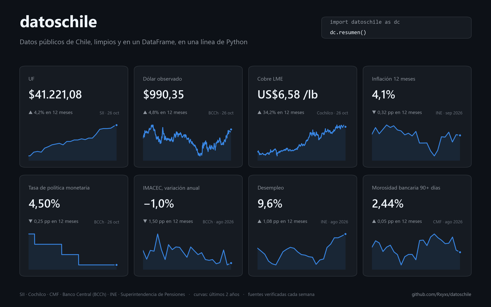

[[English](README.en.md) ] | [Español ]

# Datos Chile

[](https://github.com/Rxyxs/datoschile/actions/workflows/tests.yml)
[](https://github.com/Rxyxs/datoschile/actions/workflows/fuentes.yml)
[](https://rxyxs.github.io/datoschile/)


**Datos públicos de Chile, limpios y en un DataFrame, en una línea.** UF, dólar, euro, UTM, IPC, TPM, IMACEC, PIB, desempleo y reservas internacionales desde el Banco Central, sin clave; precios diarios del cobre y otros metales desde Cochilco; valores cuota de las AFP; morosidad bancaria de la CMF; las 346 comunas con su código CUT y el Censo 2024; feriados legales y días hábiles; y conversiones entre pesos, UF y pesos de otra fecha.

[](https://rxyxs.github.io/datoschile/)

**[Abrir el panel interactivo →](https://rxyxs.github.io/datoschile/)** Se reconstruye cada semana con esta misma librería: gráficos con rango de tiempo y detalle al pasar el cursor, los fondos A a E en UF, los próximos feriados, una calculadora de "¿cuánto vale hoy?" y un mapa y tabla del Censo 2024 por comuna.

```python
import datoschile as dc

dc.resumen()                                          # último valor de 9 indicadores, con su fuente
dc.indicadores.uf(desde=2020)                         # UF diaria, corregida
dc.bcentral.serie("imacec")                           # serie oficial del Banco Central
dc.cochilco.cobre(desde=2024)                         # cobre LME del día, US$/lb
dc.sii.utm_ipc(desde=2010)                            # UTM, UTA e IPC empalmado
dc.convertir.deflactar(1_000_000, "2015-01-15")       # esos pesos, en pesos de hoy
dc.calendario.dias_habiles("2026-09-01", "2026-09-30")
dc.territorio.buscar_cut(["Ñuñoa", "Llay-Llay"])      # [13120, 5703], sin conexión
dc.territorio.poblacion()                             # Censo 2024 por comuna
dc.pensiones.indice(fondos="A", desde=2008, real=True)  # índice del fondo en UF
dc.cmf.morosidad(desde="2020-01")                     # panel mensual por banco
```

## Por qué existe

Estas fuentes son públicas y no piden clave, pero ninguna se puede usar tal como viene. Cada problema de abajo apareció trabajando con datos reales, y la librería lo resuelve una vez para que nadie más tenga que encontrarlo:

| Fuente | Problema real | Qué hace datoschile |
|---|---|---|
| UF (mindicador.cl) | El 29 y 30 de diciembre de 2014 la "UF" vale **608,15 y 607,38**: es el dólar filtrado en la serie. Un índice deflactado salta ×40 y vuelve. | Descarta todo día que se mueva más de 1% respecto del último valor válido (la UF nunca lo hace) y lo rellena. Si mindicador no responde, usa el SII. |
| UF (mindicador.cl) | El 11-07-2015 aparece cinco veces; faltan el 12-12-2015 y el 31-12-2015. | Colapsa copias idénticas, **falla si dos copias no coinciden**, e interpola geométricamente, que es como se calcula la UF. |
| IPC (SII) | El IPC en puntos **cambia de base cuatro veces** (enero de 2010, 2014, 2019 y 2024: de 134,10 a 101,72 en 2024). Una inflación a 12 meses calculada sobre la serie publicada se equivoca hasta en **25,8 puntos**. | Detecta cada cambio de base porque el salto no calza con la variación mensual oficial y empalma la serie. Contra la inflación a 12 meses oficial, en 213 meses, la diferencia máxima es 0,075 puntos (redondeo). |
| IPC (SII) | Diciembre de 2011 trae la variación como `0.6` (con punto) y febrero de 1992 como `(-0,6)`. | Lee ambos; hay un test para cada uno. |
| Cobre (Banco Central y mindicador.cl) | La "libra de cobre" que publica el Banco Central (y que mindicador copia: 99,7% de los días idénticos) no es el precio LME del día: coincide al centavo con el de Cochilco solo el **9%** de los días de 2013 a 2025 y, con el mejor desfase (1 a 2 días), ~20%, con 2 centavos de error medio. | `cochilco.cobre()` trae el precio oficial LME del mismo día. |
| IMACEC y desempleo (mindicador.cl) | mindicador guarda la **primera cifra publicada** y no la revisa: el IMACEC de abril de 2020 aparece como −14,1% y el vigente del Banco Central es −15,1%. Solo el **3,8%** de los meses de 2013 a 2025 coincide (hasta 2,8 puntos de diferencia). El desempleo es igual desde 2020, pero 2013–2019 son cifras anteriores a la revisión del INE (hasta 0,55 puntos). | `bcentral.serie("imacec")` y `bcentral.serie("desempleo")` traen la serie vigente; `resumen()` y el panel las usan. Estas dos no caen a mindicador cuando el Banco Central no responde, para no mezclar versiones. |
| Metales (Cochilco) | El oro y la plata dejaron de actualizarse (Londres hasta nov-2025, COMEX hasta mar-2026), sin aviso en la página. | `cochilco.precio()` avisa con un `warning` cuando una serie lleva más de 30 días sin datos. |
| Feriados | Las listas usuales omiten el 17 y el 20 de septiembre de 2010 (Ley 20.450, Bicentenario); una pone la elección de 2009 el viernes 11 y fue el domingo 13. El Día de los Pueblos Indígenas cae el día del solsticio **en hora de Chile**: en 2025 fue el 20 aunque en UTC el solsticio fue el 21. | Calcula los feriados desde la ley y los valida contra dos fuentes independientes (abajo). |
| Valores cuota (Superintendencia de Pensiones) | El encabezado que dice qué AFP va en cada columna **cambia 31 veces** en el archivo del fondo C. Leído con un solo encabezado, las columnas se desalinean en silencio. | Vuelve a leer el encabezado cada vez que aparece. `indice()` pondera el retorno de cada AFP por su patrimonio del día anterior y, con `real=True`, lo deflacta por la UF corregida. |
| Morosidad (CMF) | 128 archivos Excel en **tres formatos** distintos entre 2016 y 2026, y bancos que se fusionan o cambian de nombre. En 2023-07 la fila del sistema viene en `---`. | Detecta el formato de cada archivo, une las fusiones en una sola serie, falla si el formato es desconocido y deja el `---` en `NaN`: no inventa un valor. |

Todas las reglas de limpieza tienen un test que reproduce el problema original.

## Instalación

```bash
pip install git+https://github.com/Rxyxs/datoschile
```

Requiere Python 3.10 o superior. Depende solo de pandas, requests y openpyxl.

## Qué trae

**`resumen()`**: una fila por indicador (UF, dólar, cobre LME, UTM, inflación a 12 meses, TPM, IMACEC, desempleo y morosidad bancaria) con su último valor, la fecha del dato, la variación en 12 meses y la fuente. Cada uno sale de su fuente oficial (Banco Central, SII, Cochilco, CMF); si una fuente no responde, esa fila queda vacía con el motivo y el resto se entrega igual.

**`bcentral`**: 17 series oficiales del [Banco Central](https://si3.bcentral.cl/Indicadoressiete/secure/Indicadoresdiarios.aspx), sin usuario ni clave. Su API pide registro, pero la página pública "Indicadores diarios" publica la historia completa de cada serie; las diarias vienen un año por página y la librería pide cada año con el mismo selector que usa la página.

| Función | Devuelve |
|---|---|
| `serie(codigo, desde, hasta)` | Diarias: `dolar`, `euro`, `uf`, `ivp`, `tpm`, `cobre`, `oro`, `plata`, `tcm` (tipo de cambio multilateral), `euro_por_dolar`, `yen_por_dolar`, desde 1997. Mensuales: `imacec` (desde 1997), `ipc` (desde 1928), `desempleo` (desde 2010), `utm` (desde 1990), `reservas` (desde 1982). Trimestral: `pib` (desde 1996). Detalle y unidades en `bcentral.SERIES`. |

**`indicadores`**: cualquier serie de [mindicador.cl](https://mindicador.cl), que replica series del Banco Central, el INE y el SII. Si mindicador no responde, la UF y el dólar se piden al SII, y TPM, IPC, UTM y euro al Banco Central (avisando con un `warning`). IMACEC y desempleo no tienen respaldo automático porque en mindicador no son las cifras vigentes (ver arriba): para esas dos conviene `bcentral.serie()`.

| Función | Devuelve |
|---|---|
| `uf(desde, hasta)` | UF diaria (un valor por día calendario) corregida. Lo corregido queda en `df.attrs["informe"]`. |
| `dolar(...)` | Dólar observado, días hábiles. |
| `serie(codigo, desde, hasta)` | Cualquiera de: `uf`, `ivp`, `dolar`, `euro`, `utm`, `ipc`, `tpm`, `imacec`, `tasa_desempleo`, `libra_cobre`, `bitcoin` (detalle en `indicadores.SERIES`). |

**`sii`**: las tablas oficiales del [SII](https://www.sii.cl/valores_y_fechas/), sin clave, desde 1990.

| Función | Devuelve |
|---|---|
| `descargar_anio("uf" \| "dolar", anio)` | La UF o el dólar observado de un año (el SII usa tres formatos de página según la época y los tres se leen). Coinciden con mindicador en todos los días de 2014 y 2024, salvo el 29 y 30 de diciembre de 2014, donde el SII trae la UF correcta. |
| `utm_ipc(desde, hasta)` | Mensual: `utm`, `uta`, `ipc` (tal como se publica), `ipc_var_mensual` (la oficial del INE) e `ipc_empalmado` (en una sola base: el que sirve para deflactar). Los cambios de base detectados quedan en `df.attrs["cambios_de_base"]`. |

**`cochilco`**: precios diarios de la [Comisión Chilena del Cobre](https://boletin.cochilco.cl/estadisticas/grafico.asp).

| Función | Devuelve |
|---|---|
| `cobre(desde, hasta, bolsa="LME")` | Cobre en dólares por libra, LME desde 1996 o COMEX desde 2005. |
| `precio(metal, desde, hasta, bolsa)` | `cobre`, `oro`, `plata`, `zinc`, `aluminio`, `niquel`, `plomo` o `estanio`, desde 2001. Metales base en US$/lb (Cochilco publica centavos), oro y plata en US$/onza troy. |

**`calendario`**: feriados legales de Chile desde 2008, calculados desde la ley y sin conexión (sirve para años futuros; las elecciones y leyes de una vez están cargadas hasta 2027).

| Función | Devuelve |
|---|---|
| `feriados(desde, hasta, regionales)` | `fecha`, `nombre`, `irrenunciable`, `ley` y `alcance`. `feriados(2026)` es todo 2026. Con `regionales=True` agrega Arica (7 de junio) y Chillán (20 de agosto). |
| `es_feriado(fecha)`, `es_habil(fecha, bancario)` | Con `bancario=True` el 31 de diciembre tampoco es hábil. |
| `dias_habiles(desde, hasta)`, `sumar_habiles(fecha, n)` | Días hábiles de un rango; la fecha `n` días hábiles después (o antes). |

**`territorio`**: regiones, provincias y comunas con su código CUT, y los agregados del [Censo 2024](https://censo2024.ine.gob.cl/) del INE.

| Función | Devuelve |
|---|---|
| `comunas()`, `regiones()` | La división político-administrativa del Censo 2024 (346 comunas, 56 provincias, 16 regiones). Viene con la librería: sin conexión. |
| `buscar_cut(nombres, region)` | El código CUT de cada nombre, tolerando tildes, mayúsculas, guiones y grafías antiguas ("NUNOA", "Llay-Llay", "Aisén", "Marchigüe"). El CUT es la llave para cruzar datos por comuna; el nombre no. |
| `poblacion(nivel)` | Por comuna, provincia o región: población, sexo, edad y escolaridad promedio, % de 0 a 13 años, % de 60 y más, % inmigrantes, % pueblos originarios, hogares, personas por hogar, viviendas y % de viviendas hacinadas. |
| `geometria(nivel)`, `limites()` | Los límites oficiales de las comunas del Censo 2024, simplificados (0,9 MB, sin conexión): `GeoDataFrame` por comuna, provincia o región (requiere `pip install datoschile[mapas]`) o GeoJSON sin dependencias. Para un mapa: `geometria().merge(poblacion(), on="cut")`. |
| `censo(nivel)` | Las ~190 variables agregadas que publica el INE (empleo, rama de actividad, transporte, materialidad de la vivienda, agua, electricidad...). |

La base del INE viene por zona y localidad; la librería la suma por comuna y comprueba que el total sea exactamente la población censada publicada (18.480.432). Dos detalles de la fuente: los promedios vienen con coma decimal (`32,8`), y algunos conteos de zonas muy pequeñas vienen reservados con `*`. Esos se suman como cero y la columna `celdas_reservadas` dice cuántos hay en cada fila, así que esos totales son un mínimo. La edad y la escolaridad promedio se recalculan ponderando por población; promediar los promedios de las zonas sería un error.

Los límites salen de la capa comunal de la cartografía del INE (765 MB repartidos en 16 GeoPackages regionales; [`ejemplos/geometria_comunas.py`](ejemplos/geometria_comunas.py) los reduce). Se simplifican como cobertura, así que las comunas vecinas siguen compartiendo borde sin huecos, y se dejan fuera los islotes de menos de ~2 km²: los fiordos del sur pesaban más que el resto del país junto. La superficie de la Región Metropolitana queda en 15.393 km² (oficial: 15.403). La comuna Antártica no tiene polígono porque el INE no la incluye en su cartografía.

**`convertir`**: para comparar montos en el tiempo. Aceptan un número y una fecha, o columnas completas.

| Función | Devuelve |
|---|---|
| `pesos_a_uf(montos, fechas)`, `uf_a_pesos(montos, fechas)` | Con la UF corregida de cada fecha. |
| `deflactar(montos, fechas, a=None)` | Pesos de cada fecha en pesos del mes `a` (por omisión, el último IPC publicado), con el IPC empalmado. |

**`pensiones`**: valores cuota y patrimonio diarios desde 2002, multifondos A–E.

| Función | Devuelve |
|---|---|
| `valor_cuota(fondos, desde, hasta, afps)` | Una fila por fecha, fondo y AFP: `valor_cuota` y `valor_patrimonio`. |
| `indice(fondos, desde, hasta, real)` | Índice del fondo (todas las AFP ponderadas por patrimonio), base 100. |

**`cmf`**: morosidad de 90 días o más, mensual, desde 2016.

| Función | Devuelve |
|---|---|
| `morosidad(desde, hasta, solo_sistema)` | Una fila por mes y banco: % moroso en `total`, `clientes`, `comercial`, `personas`, `consumo`, `vivienda`, y el monto moroso en MM$. |

`desde` y `hasta` aceptan un año (`2020`), un mes (`"2020-03"`) o una fecha (`"2020-03-15"`).

### Desde la terminal

```bash
datoschile resumen
datoschile bcentral imacec --desde 2015 -o imacec.csv
datoschile uf --desde 2020 -o uf.csv
datoschile metal cobre --desde 2024 --bolsa COMEX
datoschile utm-ipc --desde 2010 -o ipc.csv
datoschile feriados --desde 2026 --hasta 2027 --regionales
datoschile censo --nivel region -o censo_regiones.csv
datoschile indice --fondos A --desde 2008 --real -o fondo_a_real.csv
datoschile morosidad --desde 2020-01 --solo-sistema
```

## Caché

Un año que ya terminó no cambia, así que se guarda en `~/.cache/datoschile` y no se vuelve a pedir; el año en curso (y los últimos tres meses de la CMF, que pueden corregirse) siempre se descarga de nuevo. La primera descarga de la UF completa toma cerca de 2 minutos porque mindicador es lento, y Cochilco tarda unos 9 segundos por año; después, los años cerrados salen del disco en centésimas de segundo. Para usar otra carpeta: `DATOSCHILE_CACHE=/ruta`. Para no usar caché: `cache=False` o `--sin-cache`.

## Verificado contra las fuentes

Los tests sin conexión corren en cada cambio (Python 3.10 a 3.13). Dos de ellos validan los feriados contra fuentes independientes:

- **La tabla anual de feriados.cl, 2009 a 2027** (capturas de cada año en archive.org): coinciden todos los años salvo las dos diferencias explicadas arriba (2009 y el Bicentenario de 2010).
- **Los días sin dólar observado del SII, 2008 a 2026**: el dólar se publica todos los días hábiles, así que un día de semana sin dólar es feriado. Los 208 días calzan con los feriados calculados, en ambas direcciones.

Otro conjunto descarga datos reales y comprueba valores conocidos. Corre **cada semana** en GitHub Actions, para enterarse si una fuente cambió su formato antes que quien la use:

- UF del 31-12-2008 = 21.452,57, el valor publicado por el SII; la fuga del dólar de 2014 se detecta y se corrige.
- Banco Central: TPM del 2-1-2024 = 8,25%; IMACEC de abril de 2020 bajo −10%; PIB de 1996 en cuatro trimestres; dólar del 2-1-2014 = 524,61, el mismo valor del SII.
- Cobre LME del 2-1-2025 = 3,9397 US$/lb en Cochilco, y los metales base siguen al día.
- UTM de enero de 2025 = $67.429; los cuatro cambios de base del IPC se detectan, y la inflación a 12 meses empalmada de enero de 2025 es la que publica el SII (4,9%).
- Censo 2024: 346 comunas que suman 18.480.432 personas; Puente Alto 568.086; Región Metropolitana 7.400.741.
- El fondo A cae entre 20% y 45% en 2008; la morosidad del sistema en febrero de 2020 es 2,04%.

```bash
pip install -e ".[dev]"
pytest                 # sin conexión
pytest -m red          # contra las fuentes reales
```

Con todo el historial, la librería reproduce las cifras de los proyectos de donde salió: el fondo A cae 24,6% y el E 3,7% entre el 20 de febrero y el 23 de marzo de 2020, y la morosidad del sistema pasa de 2,04% (feb-2020) a 1,26% (dic-2021) y a 2,44% (ago-2026).

## El panel y la portada

- [`ejemplos/sitio.py`](ejemplos/sitio.py) genera el [panel web](https://rxyxs.github.io/datoschile/): una sola página HTML, sin dependencias, con los datos incrustados. El workflow `panel` la reconstruye cada lunes y la publica en GitHub Pages.
- [`ejemplos/portada.py`](ejemplos/portada.py) genera la imagen de arriba.

## Fuentes y advertencias

- **mindicador.cl** es un agregador de terceros, no el publicador oficial, y se cae: en octubre de 2026 devolvió errores 500 varios días. La UF y el dólar tienen respaldo automático en el SII, y TPM, IPC, UTM y euro en el Banco Central. Para IMACEC y desempleo, usar `bcentral.serie()` directamente.
- **Banco Central**: [Indicadores diarios](https://si3.bcentral.cl/Indicadoressiete/secure/Indicadoresdiarios.aspx). Las páginas llevan un parámetro opaco que la librería lee del índice en cada sesión; si el Banco Central cambia el diseño, el test semanal lo detecta.
- **SII**: [UF](https://www.sii.cl/valores_y_fechas/uf/uf2026.htm), [dólar](https://www.sii.cl/valores_y_fechas/dolar/dolar2026.htm) y [UTM, UTA e IPC](https://www.sii.cl/valores_y_fechas/utm/utm2026.htm). La tabla del dólar del mes en curso a veces se carga con días de atraso; `resumen()` toma el dólar de mindicador y cae al SII solo si mindicador no responde.
- **Cochilco**: [boletín de precios de metales](https://boletin.cochilco.cl/estadisticas/grafico.asp).
- **Superintendencia de Pensiones**: [valores cuota y patrimonio](https://www.spensiones.cl/apps/valoresCuotaFondo/vcfAFP.php). La serie incluye fines de semana con valores casi planos; para modelos de volatilidad conviene quedarse con días hábiles.
- **INE, Censo 2024**: [base agregada por zona y localidad](https://storage.googleapis.com/bktdescargascenso2024/Datos_agregados/Base_zona_localidad_CPV24.zip) y diccionario de variables, [licencia de datos abiertos del INE](https://www.ine.gob.cl/terminos-de-uso-y-licencia-de-datos-abiertos).
- **CMF**: [estadísticas de morosidad](https://www.cmfchile.cl/portal/estadisticas/626/w4-propertyvalue-28914.html).
- **Feriados**: el texto de cada ley en la [Biblioteca del Congreso Nacional](https://www.bcn.cl/leychile). Los feriados regionales que se declaran por una sola vez (por ejemplo, la visita del Papa en 2018) no están incluidos.

La librería descarga a un ritmo moderado (una pausa entre pedidos) y guarda en caché lo que no cambia, para no cargar servicios públicos.

## Licencia

MIT — ver [LICENSE](LICENSE).

## Autor

**Pablo Reyes** — [github.com/Rxyxs](https://github.com/Rxyxs)
